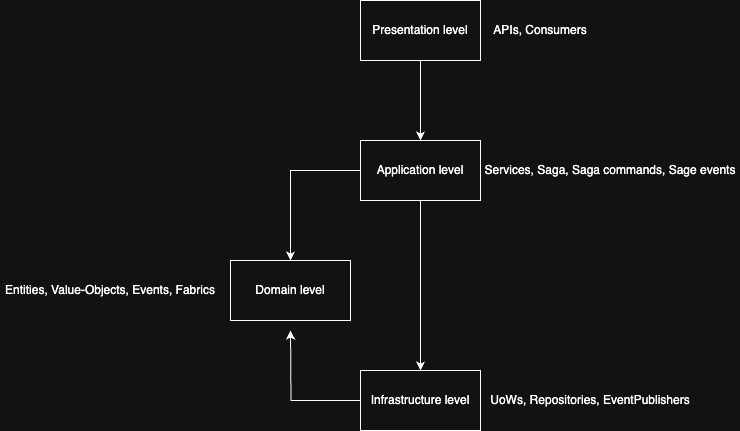
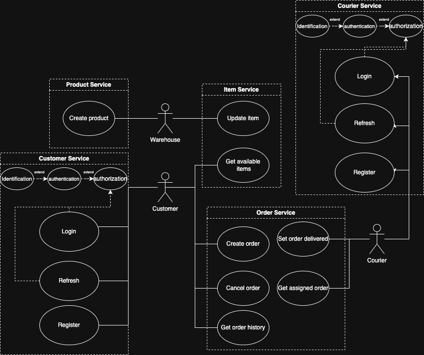
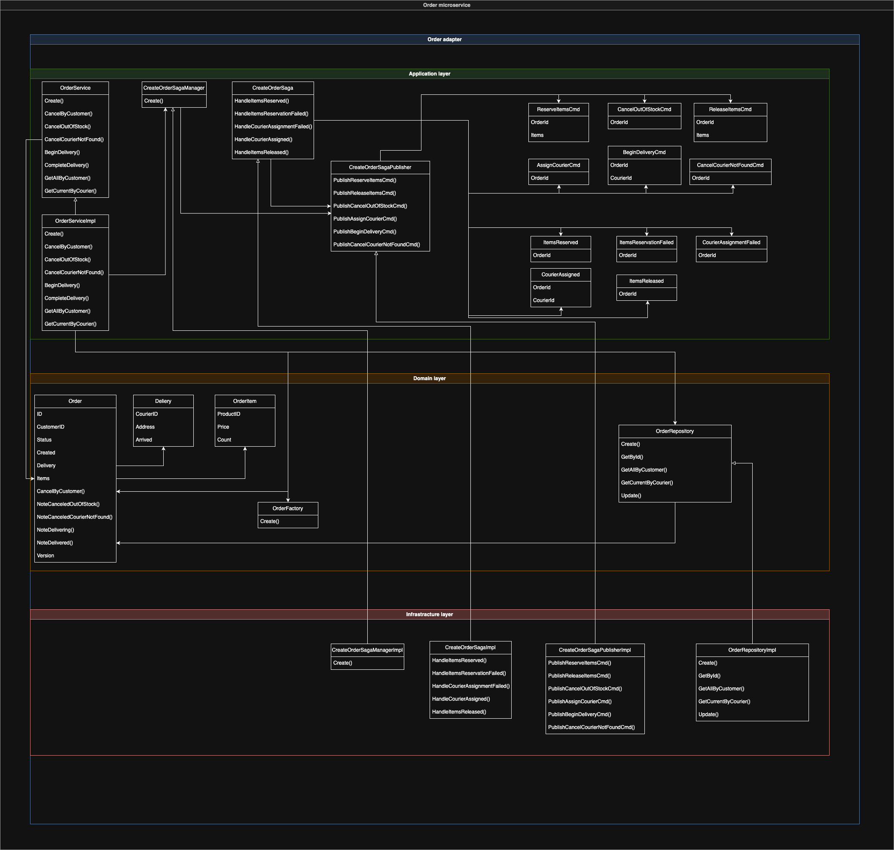
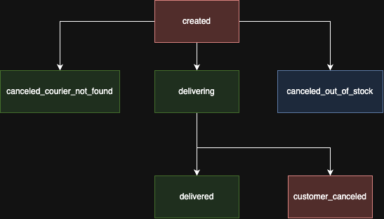
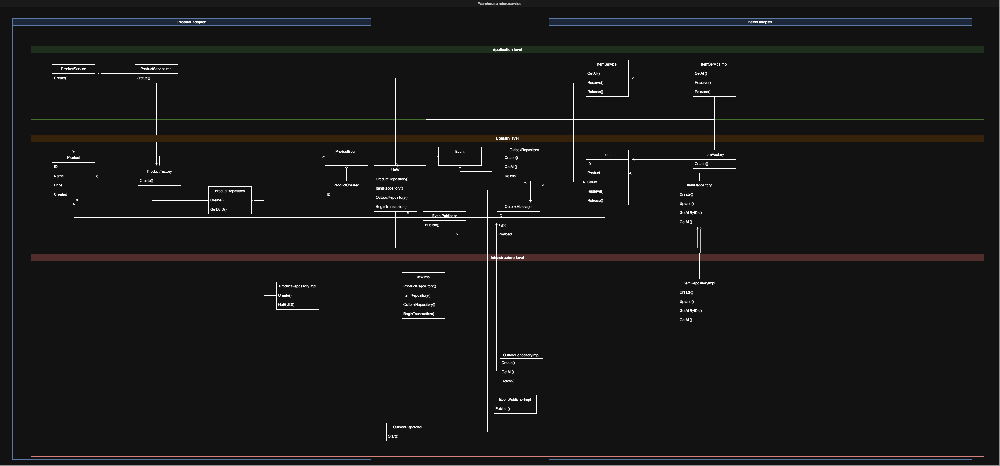
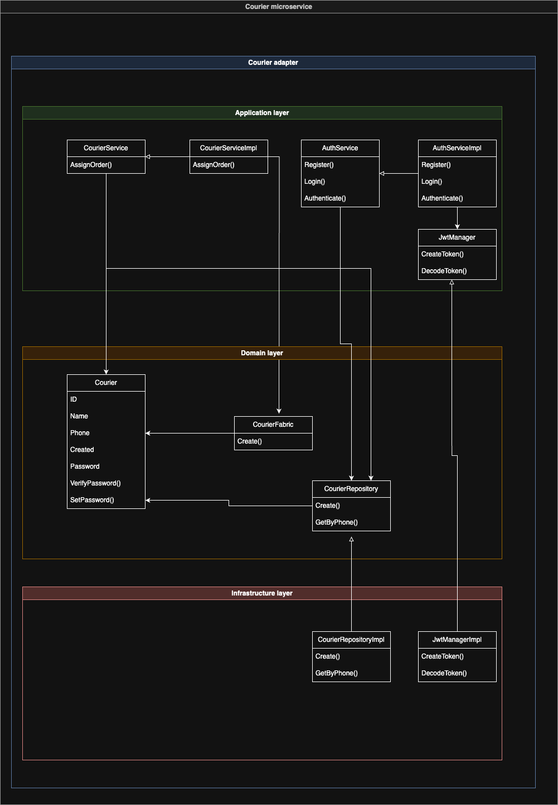
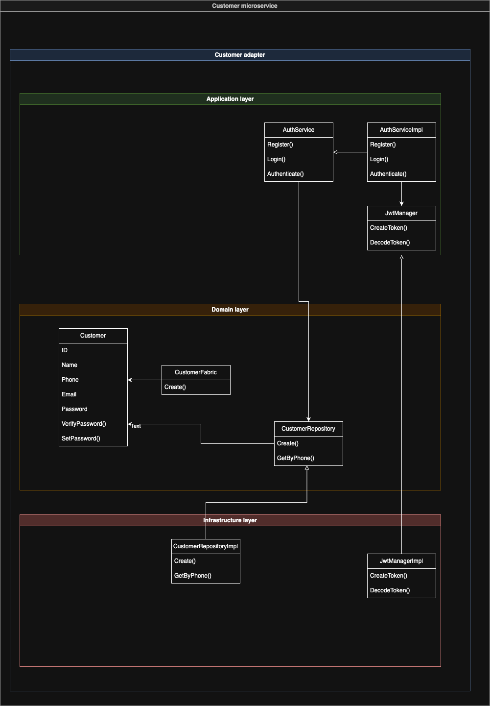
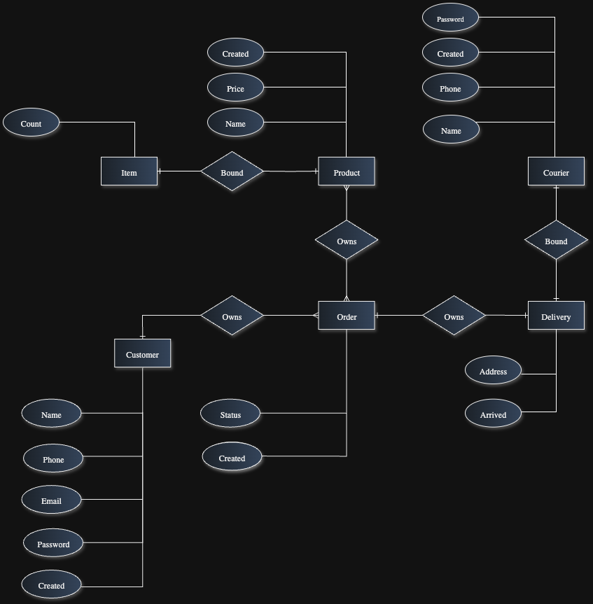
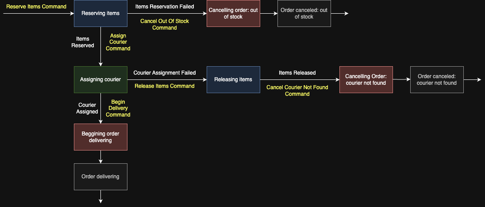
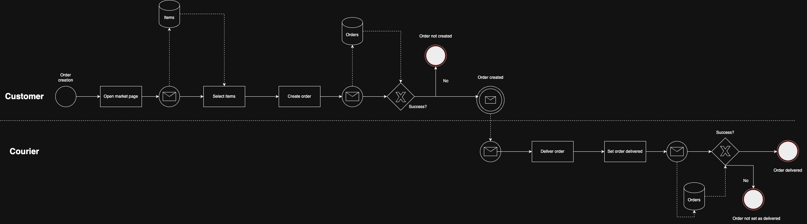

# Warehouse Delivery Service

[](https://go.dev/)
[](https://www.docker.com/)
[](https://kafka.apache.org/)
[](https://www.postgresql.org/)
[](https://www.mongodb.com/)
[](https://grpc.io/)

A production-grade distributed delivery service built with **Go**, following **Domain-Driven Design** and **microservices architecture**. The system manages the full order lifecycle — from product browsing and order placement to warehouse inventory management and courier delivery — using event-driven communication, orchestrator saga, and the transactional outbox pattern.

> Self-hosted solution for small businesses to manage warehouse inventory and delivery logistics without relying on third-party delivery platforms.

**Repository:** [github.com/OlegDokuchaev/clean-ddd-app](https://github.com/OlegDokuchaev/clean-ddd-app)

---

## Table of Contents

- [Architecture Overview](#architecture-overview)
- [Tech Stack](#tech-stack)
- [Microservices](#microservices)
- [Domain-Driven Design](#domain-driven-design)
- [Key Architectural Patterns](#key-architectural-patterns)
  - [Saga Orchestration](#saga-orchestration)
  - [Transactional Outbox](#transactional-outbox)
  - [Chunk Streaming via MinIO](#chunk-streaming-via-minio)
- [Infrastructure & Observability](#infrastructure--observability)
- [API Documentation](#api-documentation)
- [Getting Started](#getting-started)
- [Testing](#testing)
- [Project Structure](#project-structure)

---

## Architecture Overview

The system is composed of **4 domain microservices** and an **API Gateway**, communicating internally via **gRPC** and asynchronously through **Apache Kafka**. Each service owns its data and encapsulates its bounded context.



**Communication patterns:**
- **Synchronous** — gRPC between API Gateway and microservices
- **Asynchronous** — Kafka for event-driven inter-service communication (saga commands, domain events)
- **External** — REST API exposed by the API Gateway with Swagger documentation

### Use Cases



**Actors:**
- **Customer** — browses products, places and cancels orders, views order history; authenticates via JWT with OTP email verification
- **Courier** — receives delivery assignments, marks orders as delivered; authenticates via JWT
- **Warehouse Admin** — manages products and inventory stock levels

---

## Tech Stack

| Category | Technologies |
|---|---|
| **Language** | Go 1.23 |
| **Service Communication** | gRPC + Protocol Buffers |
| **API Gateway** | Gin (REST) + Swagger/OpenAPI |
| **Message Broker** | Apache Kafka |
| **Databases** | PostgreSQL, MongoDB |
| **Caching** | Redis |
| **Object Storage** | MinIO (S3-compatible) |
| **Dependency Injection** | Uber fx |
| **Authentication** | JWT (HS256) + bcrypt + OTP |
| **Distributed Tracing** | OpenTelemetry + Jaeger |
| **Logging** | Logrus + Logstash + Elasticsearch + Kibana (ELK) |
| **Metrics** | Prometheus + Grafana + cAdvisor |
| **Database Migrations** | golang-migrate |
| **Containerization** | Docker + Docker Compose |
| **ORM** | GORM (PostgreSQL), MongoDB Go Driver |

---

## Microservices

### Order Service

Manages the full order lifecycle and orchestrates the distributed **Create Order Saga** across Warehouse and Courier services.

- **Database:** MongoDB — document model fits the nested order structure (items, delivery info)
- **Patterns:** Saga orchestration, optimistic locking (version-based)
- **Kafka:** Publishes saga commands, consumes saga events from Warehouse and Courier



**gRPC API:**
| Method | Description |
|---|---|
| `CreateOrder` | Places a new order and initiates the saga |
| `CancelOrderByCustomer` | Customer-initiated cancellation |
| `CompleteDelivery` | Marks order as delivered |
| `GetOrdersByCustomer` | Returns customer's order history |
| `GetCurrentOrdersByCourier` | Returns courier's active deliveries |

**Order statuses:**



---

### Warehouse Service

Manages product catalog and inventory stock. Implements the **Transactional Outbox** pattern for reliable event publishing and **Unit of Work** for atomic transactions. Stores product images in **MinIO** with gRPC chunk streaming.

- **Database:** PostgreSQL (with primary-replica replication)
- **Object Storage:** MinIO for product images
- **Patterns:** Outbox, Unit of Work, optimistic locking



**gRPC API:**
| Method | Description |
|---|---|
| `CreateProduct` | Creates a product with a default image |
| `ReserveItem` | Reserves stock (saga participant) |
| `ReleaseItem` | Releases reserved stock (saga compensation) |
| `GetAllItems` | Lists all inventory items |
| `UpdateImage` | Client-streaming: uploads product image in chunks |
| `GetImage` | Server-streaming: downloads product image in chunks |

---

### Courier Service

Handles courier registration, authentication, and order assignment during the delivery saga.

- **Database:** PostgreSQL
- **Authentication:** JWT with bcrypt password hashing



**gRPC API:**
| Method | Description |
|---|---|
| `Register` | Courier registration |
| `Login` | Returns JWT token |
| `Authenticate` | Validates JWT and extracts courier identity |
| `AssignCourier` | Assigns a courier to an order (saga participant) |

---

### Customer Service

Manages customer accounts with a secure multi-step authentication flow: password login, OTP email verification, and JWT token issuance. Implements account lockout after repeated failed attempts.

- **Database:** PostgreSQL
- **Cache:** Redis for OTP storage with TTL and atomic verification
- **Email:** SMTP integration for OTP delivery
- **Security:** Account lockout policy, password reset flow



**gRPC API:**
| Method | Description |
|---|---|
| `Register` | Customer registration |
| `Login` | Validates password, sends OTP via email |
| `VerifyOtp` | Validates OTP, returns JWT tokens |
| `RequestPasswordReset` | Sends reset token via email |
| `CompletePasswordReset` | Validates reset token, updates password |
| `Authenticate` | Validates access token |

---

### API Gateway

Single entry point for all external clients. Translates REST/HTTP requests into gRPC calls to downstream microservices. Provides Swagger UI for interactive API exploration.

- **Framework:** Gin with middleware stack (logging, tracing, panic recovery)
- **Auth:** JWT Bearer tokens (Customer, Courier), API key (Admin)
- **Docs:** Auto-generated Swagger/OpenAPI at `/api/v1/swagger`
- **Tracing:** Injects and propagates W3C Trace Context headers

---

## Domain-Driven Design

The project follows a strict **layered DDD architecture** within each microservice:

```
┌─────────────────────────────────────┐
│         Presentation Layer          │  gRPC handlers, Kafka consumers
├─────────────────────────────────────┤
│         Application Layer           │  Use cases, sagas, DTOs
├─────────────────────────────────────┤
│           Domain Layer              │  Aggregates, value objects,
│                                     │  repository interfaces, events
├─────────────────────────────────────┤
│        Infrastructure Layer         │  DB, Kafka, MinIO, Redis,
│                                     │  telemetry, logging
└─────────────────────────────────────┘
```

### Bounded Contexts & Aggregates

| Bounded Context | Aggregates | Database |
|---|---|---|
| **Order** | Order (with Items, Delivery value objects) | MongoDB |
| **Warehouse** | Product (with Image), Item, Outbox Message | PostgreSQL |
| **Courier** | Courier | PostgreSQL |
| **Customer** | Customer | PostgreSQL + Redis |

### Entity-Relationship Model



### Key DDD Building Blocks

- **Aggregates** — enforce invariants and encapsulate business rules (e.g., `Item.Reserve()` validates stock availability)
- **Value Objects** — immutable domain concepts (OrderItem, Delivery, Image)
- **Domain Events** — capture state changes (ProductCreated, ItemsReserved)
- **Repository Interfaces** — defined in domain layer, implemented in infrastructure
- **Factories** — encapsulate aggregate creation logic with validation
- **Unit of Work** — coordinates atomic transactions across multiple repositories

---

## Key Architectural Patterns

### Saga Orchestration

The **Create Order Saga** coordinates a distributed transaction across Order, Warehouse, and Courier services. The Order service acts as the orchestrator, driving the workflow through Kafka commands and compensating on failure.



*Yellow nodes — commands published by the saga. White nodes — events returned by participants.*

**Happy path:**
1. Order created → `ReserveItemsCmd` → Warehouse
2. Items reserved → `AssignCourierCmd` → Courier
3. Courier assigned → `BeginDeliveryCmd` → Order moves to `Delivering`

**Compensation flows:**
- Items out of stock → Order canceled (`CanceledOutOfStock`)
- No courier available → `ReleaseItemsCmd` → Warehouse releases stock → Order canceled (`CanceledCourierNotFound`)

### Transactional Outbox

The Warehouse service uses the **Outbox pattern** to guarantee reliable event delivery to Kafka, solving the dual-write problem:

```
┌──────────────────────────────────────────────────┐
│              PostgreSQL Transaction               │
│                                                  │
│  1. Save Product/Item changes                    │
│  2. Insert OutboxMessage (event + trace context) │
│                                                  │
│  ── both succeed or both rollback ──             │
└──────────────────────────────────────────────────┘
                      │
          ┌───────────▼───────────┐
          │  Background Processor │  polls every 1s
          │                       │
          │  3. Read unpublished  │
          │  4. Publish to Kafka  │
          │  5. Delete from DB    │
          └───────────────────────┘
```

OpenTelemetry trace context is preserved in the outbox message metadata and injected into Kafka headers, maintaining distributed tracing across the async boundary.

### Chunk Streaming via MinIO

Product images are stored in **MinIO** (S3-compatible object storage) and transferred via **gRPC streaming** in configurable chunks, avoiding loading entire files into memory:

```
Upload:   Client ──[chunk₁]──[chunk₂]──[chunkₙ]──▸ API Gateway ──▸ Warehouse ──▸ MinIO
                        (client streaming)

Download: MinIO ──▸ Warehouse ──[chunk₁]──[chunk₂]──[chunkₙ]──▸ API Gateway ──▸ Client
                        (server streaming, 32KB chunks)
```

The API Gateway streams chunks directly between the HTTP client and the gRPC service using `io.Pipe()`, keeping memory footprint constant regardless of file size.

---

## Infrastructure & Observability

The project includes a complete observability stack:

| Component | Purpose | Port |
|---|---|---|
| **Jaeger** | Distributed tracing UI | `16686` |
| **Prometheus** | Metrics collection | `9090` |
| **Grafana** | Metrics dashboards | `3000` |
| **Elasticsearch** | Log storage | `9200` |
| **Logstash** | Log processing pipeline | `5001` |
| **Kibana** | Log exploration UI | `5601` |
| **cAdvisor** | Container metrics | — |
| **MinIO Console** | Object storage management | `9001` |

### Database Infrastructure

| Service | Database | Port | Notes |
|---|---|---|---|
| Order | MongoDB | `27017` | Document store for nested order data |
| Warehouse | PostgreSQL | `5445` | Primary-replica replication |
| Courier | PostgreSQL | `5446` | — |
| Customer | PostgreSQL | `5447` | — |
| Customer (cache) | Redis | `6379` | OTP storage with TTL |

### Tracing

All services are instrumented with **OpenTelemetry SDK** exporting traces via **OTLP gRPC** to **Jaeger**. Trace context propagates through:
- gRPC metadata (synchronous calls)
- Kafka headers (asynchronous events, including through the outbox)

---

## API Documentation

Interactive Swagger UI is available at:

```
http://localhost:8082/api/v1/swagger/index.html
```

Authentication methods:
- **CustomerBearerAuth** — JWT in `Authorization: Bearer <token>` header
- **CourierBearerAuth** — JWT in `Authorization: Bearer <token>` header
- **AdminAccessToken** — API key in `X-Access-Token` header

---

## Getting Started

### Prerequisites

- [Docker](https://docs.docker.com/get-docker/) and [Docker Compose](https://docs.docker.com/compose/install/)

### Run the Project

1. **Clone the repository:**

```bash
git clone https://github.com/OlegDokuchaev/clean-ddd-app.git
cd clean-ddd-app
```

2. **Start all services:**

```bash
docker compose up -d
```

This launches the entire stack: databases, Kafka, microservices, API Gateway, and observability tools.

3. **Verify services are running:**

```bash
docker compose ps
```

4. **Access the application:**

| Service | URL |
|---|---|
| API Gateway (REST) | `http://localhost:8082` |
| Swagger UI | `http://localhost:8082/api/v1/swagger/index.html` |
| Jaeger (Tracing) | `http://localhost:16686` |
| Grafana (Metrics) | `http://localhost:3000` |
| Kibana (Logs) | `http://localhost:5601` |
| MinIO Console | `http://localhost:9001` |
| Prometheus | `http://localhost:9090` |

### Environment Configuration

Each microservice has a `.env.example` file documenting all required environment variables. The default `.env` files are pre-configured for the Docker Compose setup.

Key configuration areas:
- Kafka broker addresses and topic names
- Database connection strings
- JWT signing keys and token TTLs
- OpenTelemetry exporter endpoints
- MinIO credentials and bucket names
- SMTP settings for email delivery

---

## Testing

The project includes a comprehensive testing strategy:

### Unit Tests
Test domain logic, aggregates, value objects, and use cases in isolation:
```bash
cd order && make unit
cd warehouse && make unit
cd courier && make unit
cd customer && make unit
```

### Integration Tests
Test repository implementations and Kafka publishers against real databases (via Testcontainers):
```bash
cd order && make integration
cd warehouse && make integration
```

### End-to-End Tests
Test complete workflows across services:
```bash
cd order && make e2e
cd customer && make e2e
```

### Code Quality
```bash
make lint           # golangci-lint
make cycloover      # Cyclomatic complexity check (threshold: 10)
make maintunder     # Maintainability index check (threshold: 20)
```

### Test Reports
Allure reports are generated for detailed test analysis:
```bash
cd order && make allure
```

---

## Project Structure

```
.
├── api-gateway/                    # REST API Gateway
│   ├── cmd/                        #   Entry point
│   ├── internal/
│   │   ├── adapter/
│   │   │   ├── input/api/          #   HTTP handlers, middleware, Swagger docs
│   │   │   └── output/clients/     #   gRPC clients to microservices
│   │   ├── domain/                 #   DTOs and use case interfaces
│   │   └── infrastructure/         #   Logger, telemetry, DI modules
│   └── proto/                      #   Proto definitions for all services
│
├── order/                          # Order Microservice
│   ├── cmd/                        #   Entry point
│   └── internal/
│       ├── domain/order/           #   Aggregate, value objects, repository interface
│       ├── application/
│       │   └── order/
│       │       ├── usecase/        #   Order use cases
│       │       └── saga/           #   Create Order Saga (orchestrator)
│       ├── infrastructure/         #   MongoDB, Kafka, telemetry
│       ├── presentation/           #   gRPC handlers, Kafka consumers
│       └── tests/                  #   Unit, integration, e2e tests
│
├── warehouse/                      # Warehouse Microservice
│   ├── cmd/                        #   Entry point
│   └── internal/
│       ├── domain/
│       │   ├── product/            #   Product aggregate
│       │   ├── item/               #   Item (stock) aggregate
│       │   ├── outbox/             #   Outbox message entity
│       │   └── uow/               #   Unit of Work interface
│       ├── application/            #   Product & Item use cases, image service
│       ├── infrastructure/         #   PostgreSQL, MinIO, Kafka, outbox processor
│       ├── presentation/           #   gRPC handlers (incl. streaming)
│       └── tests/
│
├── courier/                        # Courier Microservice
│   ├── cmd/
│   └── internal/
│       ├── domain/courier/         #   Courier aggregate
│       ├── application/            #   Auth & assignment use cases
│       ├── infrastructure/         #   PostgreSQL, JWT, Kafka
│       ├── presentation/           #   gRPC handlers
│       └── tests/
│
├── customer/                       # Customer Microservice
│   ├── cmd/
│   └── internal/
│       ├── domain/customer/        #   Customer aggregate (with lockout policy)
│       ├── application/            #   Auth use cases (login, OTP, password reset)
│       ├── infrastructure/         #   PostgreSQL, Redis, JWT, mail sender
│       ├── presentation/           #   gRPC handlers
│       └── tests/
│
├── configs/                        # Infrastructure configs
│   ├── elasticsearch/
│   ├── logstash/
│   ├── kibana/
│   ├── prometheus/
│   └── otel-collector/
│
├── docker-compose.yml              # Full infrastructure orchestration
└── .env                            # Root environment variables
```

### Business Process Model


